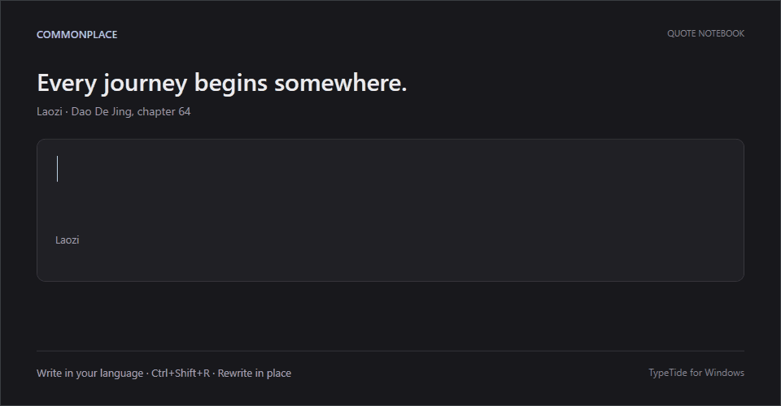
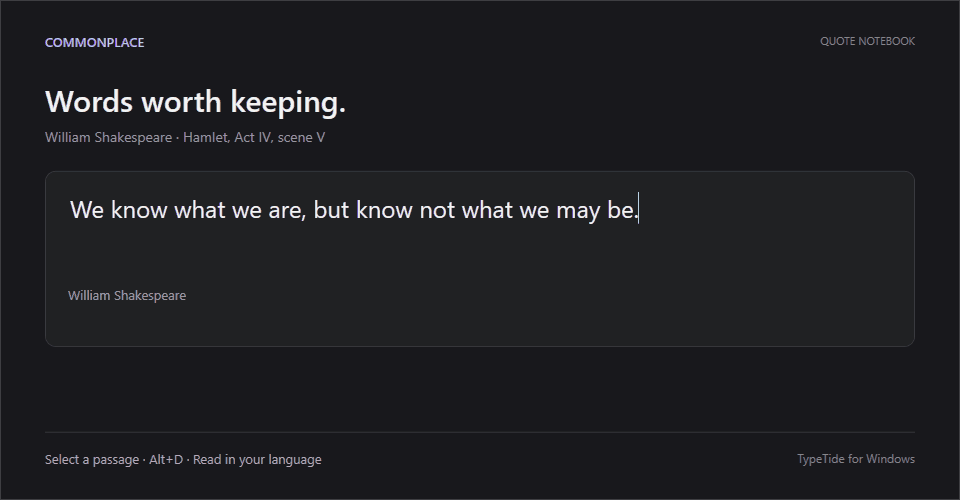
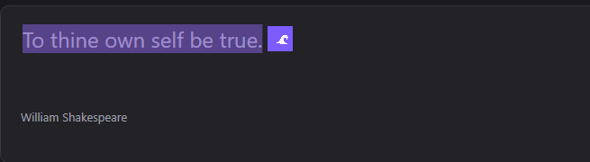

<h1 align="center">TypeTide</h1>
<p align="center"><b>Type in your language. Rewrite in place — in any app on Windows.</b></p>

<p align="center">
  
  
  
  
</p>

<p align="center">
  <a href="https://github.com/Big-Molecule/typetide"><b>GitHub</b></a> ·
  <b>English</b> · <a href="README.zh-CN.md">简体中文</a>
</p>

> Windows-focused fork of [everettjf/typetide](https://github.com/everettjf/typetide). This fork continues development on the Windows client only; see [differences from upstream](#-differences-from-upstream).

TypeTide turns translation into an in-place system action. It lives in the system tray and works in **any** app:

- **Read** — select foreign text, hit a shortcut, and a translation pops up next to it.
- **Write** — **type in your own language**, hit a shortcut, and it's rewritten in place into the target language, ready to send.

No browser tab and no copy-paste loop. Backends: **Ollama** (offline, private) or any **OpenAI-compatible** endpoint (`/chat/completions`, SSE streaming).

<p align="center">
  
  <br/><sub><i>Write · type in your language, press <kbd>Ctrl+Shift+R</kbd>, and it's rewritten in place.</i></sub>
</p>

<p align="center">
  
  <br/><sub><i>Read · select text and the translation streams into a popup — Copy or Replace.</i></sub>
</p>

<p align="center">
  
  <br/><sub><i>Optional floating icon appears right next to your selection.</i></sub>
</p>

---

## ✨ Features

- **Read · translate** — select text anywhere → popup with the translation. Trigger by shortcut, a floating icon next to the selection, or auto-translate on select.
- **Write · rewrite in place** — write in your native language, press the rewrite shortcut, and the input field is replaced with the translation. Replace immediately or preview first.
- **Works in every app** — uses UI Automation to read the selection, with a clipboard-copy fallback for Electron/web apps, so it works even where text APIs don't. The original clipboard is always restored.
- **Undo-safe replacement** — replacements are pasted, preserving each app's native undo stack.
- **Local or cloud** — pluggable backends: **Ollama** (offline, private) or any **OpenAI-compatible** API (`/chat/completions`, streaming). Switch in Settings.
- **Model picker** — Settings lists your installed Ollama models, recommends a comfortable size from physical memory, and auto-selects an installed model when the configured one is missing. Thinking models (qwen3 family, …) are handled — hidden reasoning is disabled so translations stay instant. For OpenAI-compatible endpoints, **Fetch models** pulls the model list from `{base}/models`; you can also just type a model name.
- **Styles** — Faithful, Formal, Casual, and Polished rewriting.
- **Shortcut actions** — each of the two global shortcuts can independently use smart direction or a fixed native/foreign target, then show a popup or replace in place.
- **Built-in checks** — first-run setup verifies the backend and shortcut registration. The backend check uses fixed synthetic text, never the clipboard.
- **Private diagnostics** — optional operational events stay on the device and can be reviewed, exported, or cleared. They contain timing, outcome, backend, and capture method only—never selected text, translations, clipboard contents, app names, URLs, or credentials.
- **Tray only** — no taskbar clutter. Global shortcuts, launch at login, per-app skip list.
- **Fully native** — Win32 C++20, CMake + Ninja. No Electron, no runtime.

## 💡 Why TypeTide

| | TypeTide | Browser translate sites | OS built-in translate |
|---|---|---|---|
| Works in any app (mail, chat, IDE, terminal) | ✅ | ❌ (paste in/out) | ⚠️ menu only |
| Rewrite **in place** for replies | ✅ | ❌ | ❌ |
| Runs 100% offline / private | ✅ (local Ollama) | ❌ | ⚠️ |
| Bring your own model / endpoint | ✅ | ❌ | ❌ |
| Streaming output | ✅ | ⚠️ | ❌ |

## 🌍 Languages

Detection and translation cover 10 languages: **English (`en`), 中文 (`zh`), हिन्दी (`hi`), Español (`es`), Français (`fr`), العربية (`ar`), বাংলা (`bn`), Русский (`ru`), Português (`pt`), and Bahasa Indonesia (`id`)**.

Pick your native and foreign language in **Settings → Language**. Each Read/Write shortcut (`Alt+D` / `Ctrl+Shift+R` by default) has its own direction: **auto** detects the selected text's language and translates the other way, or pin a **fixed** direction for mixed-language text.

## 🚀 Quick start

**1. Install TypeTide**

Download the latest `TypeTide-Setup-x.y.z.exe` from [Releases](https://github.com/Big-Molecule/typetide/releases) and run it (per-user, no admin needed; a portable `TypeTide-Windows-x.y.z.zip` is also available). If SmartScreen warns about an unrecognized app, choose **More info → Run anyway**.

**2. Pick a backend**

**Local with Ollama:** install [Ollama](https://ollama.com/download), then:

```powershell
winget install Ollama.Ollama
ollama pull qwen3.5:4b   # or any compact chat model that fits your hardware
ollama serve             # usually already running as a service
```

**Or cloud:** in **Settings → Backend**, choose *OpenAI-compatible API*. Presets for OpenAI, OpenRouter, and DeepSeek are included, plus any custom endpoint; **Fetch models** lists the models the endpoint offers. API keys are kept in Windows Credential Manager rather than the settings JSON.

TypeTide lists your installed Ollama models in **Settings → Backend** and auto-picks an installed one if the configured model is missing — pulling *any* chat model is enough to get going.

**3. First run**

Windows needs no special permission. Then:

- Select text → **Alt+D** → see the translation.
- Type in your language → **Ctrl+Shift+R** → it's rewritten in place.

Shortcuts, their actions, triggers, styles, and languages are all configurable in **Settings**. Either shortcut can be cleared completely; keep at least one configured if you want keyboard triggering. Windows combinations may also include the Windows key. Use **Test Connection** and **Verify Shortcuts** to confirm the complete path before relying on it.

## ⌨️ Default shortcuts

| Action | Windows |
|---|---|
| Translate selection (read) | <kbd>Alt</kbd><kbd>D</kbd> |
| Rewrite & replace (write) | <kbd>Ctrl</kbd><kbd>Shift</kbd><kbd>R</kbd> |

These are defaults, not requirements. Clear either shortcut in **Settings → Shortcuts**; if both are cleared, TypeTide warns that keyboard triggering is unavailable.

## 🧠 How it works

```
Select / type  ─►  Shortcut · floating icon · auto
                          │
      Capture (UI Automation selection ─► clipboard fallback)
                          │
              Translate (Ollama / OpenAI-compatible, streaming)
                          │
        Read: popup  ·  Write: paste in place (undo-safe)
```

## 🔒 Privacy and system access

TypeTide reads and replaces selected text across applications via UI Automation; no separate permission prompt is needed. Capture happens only after a configured shortcut, floating-icon click, or auto-translate selection event. Apps containing sensitive text can be disabled in **Settings → Excluded apps**; use **shortcut only** mode when you do not want passive selection monitoring.

- With **Ollama**, captured text is sent only to the Ollama service on `127.0.0.1`. TypeTide has no hosted relay or telemetry service.
- With an **OpenAI-compatible backend**, captured text is sent to the configured base URL when translation is triggered. That provider's retention and privacy policy applies; do not use a cloud backend for secrets or sensitive text.
- Some apps do not expose their selection through accessibility APIs. TypeTide then briefly copies the selection, reads it, and restores the previous clipboard contents. Clipboard managers may still record that temporary copy.
- API keys are stored in Windows Credential Manager.

## 🏗️ Project structure

```
windows/               # Native Win32 C++20 app (CMake)
├── src/               # Tray, hotkeys, UIA capture, popup, providers,
│                      # settings window, replacer, language detection
├── installer/         # Inno Setup script
├── scripts/           # Build / test / mock-backend scripts
└── assets/            # Icon

contracts/             # Shared translation behavior contracts
scripts/               # Version bump + release scripts
docs/                  # Screenshots + notes
```

## 🔨 Build & release

Requirements: Windows 10+, Visual Studio 2022+ Build Tools (MSVC, CMake, Ninja). No third-party dependencies — pure Win32 + WinHTTP + UI Automation.

```powershell
cd windows
cmake -B build -G Ninja -DCMAKE_BUILD_TYPE=Release
cmake --build build             # → build/TypeTide.exe
```

**Releasing** — the version lives in the root `VERSION` file:

```powershell
./scripts/bump-version.sh            # patch +1, syncs CMake / rc / manifest
# commit, then:
./scripts/release-windows.ps1        # builds installer + zip, creates release, uploads
```

Requires `gh auth login` once.

## 🔧 Troubleshooting

- **Shortcut does nothing** → another app may own the hotkey — pick a different one in Settings → Shortcuts.
- **No translation** → Ollama: is `ollama serve` running and the model installed? (TypeTide auto-picks an installed model if your configured one is missing.) OpenAI: check base URL / key / model.
- **Translation is very slow on a qwen3-class model** → TypeTide disables hidden "thinking", preloads the selected model, and keeps it warm for 10 minutes. If it still crawls, the model may be too big for your hardware — try a smaller one from **Settings → Backend**.
- **Misaligned popup in some apps** → those apps don't expose text bounds; the popup falls back to the cursor position.
- **Which language goes where?** → In **Settings → Language**, pick your **native** and **foreign** language (there is no "source/target" pair to get backwards). Each shortcut has its own direction; **auto** detects the selected text and translates the other way.

## 🪟 Differences from upstream

This fork tracks the Windows client of [everettjf/typetide](https://github.com/everettjf/typetide) and drops the macOS app:

- **Windows only** — the SwiftUI/`macos/` tree is removed; Windows is the sole supported platform.
- **Plain-HTTP OpenAI-compatible endpoints allowed** — upstream refuses to send API keys over anything but HTTPS or loopback; this fork lets you point at LAN services over HTTP (unencrypted — use only on trusted networks).
- **Fetch models** — pull the model list from an OpenAI-compatible endpoint's `/models` and pick from a dropdown; hand-typed model names still work.
- **Streaming UI reworked** — input hooks run on a dedicated thread so rendering can never stall the system mouse; translation deltas are batched at ~30 fps instead of one message per token.
- **Update check points at this fork** (`TYPETIDE_UPDATE_REPO` build option), and About links to this repository.

## 🤝 Contributing

Issues and PRs welcome. The maintained README languages are English and Simplified Chinese.

## 📄 License

[MIT](LICENSE) · Based on TypeTide by [everettjf](https://github.com/everettjf). If TypeTide helps you, a ⭐️ is appreciated!
