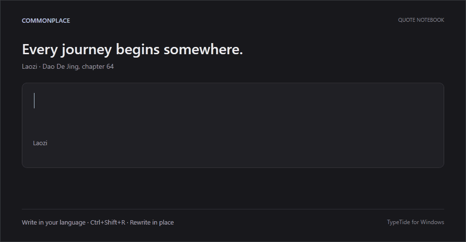
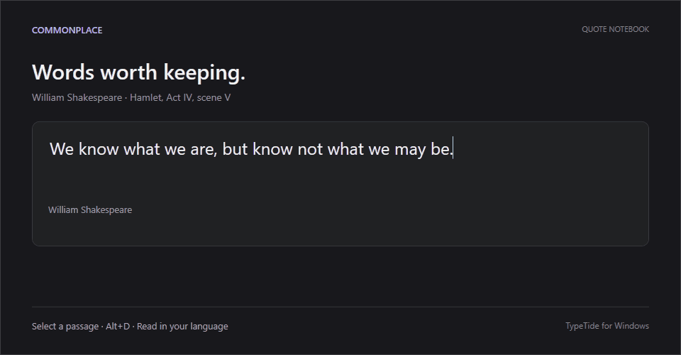
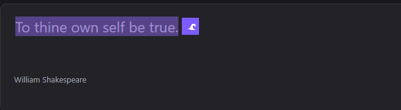

<h1 align="center">TypeTide</h1>
<p align="center"><b>纯净精简的划词翻译 —— 选中外文一键读懂，用母语输入一键改写。</b></p>

<p align="center">
  
  
  
  
</p>

<p align="center">
  <a href="https://github.com/Big-Molecule/typetide"><b>GitHub</b></a> ·
  <b>English</b> · <a href="README.zh-CN.md">简体中文</a>
</p>

TypeTide 把翻译变成一个原地完成的系统动作。它常驻系统托盘，在**任何**应用里都能用：

- **读** — 选中外语文字，按下快捷键，译文就在旁边弹出。
- **写** — **用母语输入**，按下快捷键，文字原地改写成目标语言，直接可以发送。

不用打开浏览器标签页，也不用在翻译网站之间来回复制粘贴。模型来自你自己的 **OpenAI 兼容** API（`/chat/completions`，流式）——云端或局域网自建网关均可，key 存在 Windows Credential Manager。

<p align="center">
  
  <br/><sub><i>写 · 用母语输入，按 <kbd>Ctrl+Shift+R</kbd>，原地改写成目标语言。</i></sub>
</p>

<p align="center">
  
  <br/><sub><i>读 · 选中文字，译文流式显示在弹窗里——可复制或替换。</i></sub>
</p>

<p align="center">
  
  <br/><sub><i>可选的浮动图标，紧贴你的选区出现。</i></sub>
</p>

---

## ✨ 功能

- **读 · 翻译** — 在任意位置选中文字 → 弹窗显示译文。可用快捷键、选区旁的浮动图标或划词自动翻译触发。
- **写 · 原地改写** — 用母语写字，按改写快捷键，输入框内容被替换成译文。可直接替换，也可先预览。
- **每个应用都能用** — 通过 UI Automation 读取选区，对 Electron/网页类应用自动降级为剪贴板复制，文字接口不可用时也能工作。原剪贴板内容总会被还原。
- **替换不破坏撤销** — 替换通过粘贴完成，保留每个应用原生的撤销栈（Ctrl+Z 随时可撤销）。
- **自带 API** — 任意 **OpenAI 兼容**端点（`/chat/completions`，流式）。内置 OpenAI、OpenRouter、DeepSeek 预设，也支持自定义 base URL。
- **模型选择** — **Fetch models** 从端点的 `{base}/models` 拉取模型列表到下拉框，也可以直接手输模型名。
- **风格** — 忠实、正式、口语、润色四种改写风格。
- **快捷键动作可组合** — 两个全局快捷键都能独立选择智能方向或固定母语/外语目标，并决定弹窗展示或原地替换。
- **内置可用性检查** — 首次设置会检查后端和快捷键注册；后端测试只发送固定合成文本，不读取剪贴板。
- **本地隐私诊断** — 运行结果、耗时、后端和取词方式只保存在本机，可查看、导出或清空；不会记录选中文字、译文、剪贴板、应用名、URL 或凭据。
- **只住托盘** — 不占任务栏。全局快捷键、开机自启、按应用跳过列表。
- **全原生** — Win32 C++20，CMake + Ninja。没有 Electron，没有运行时。

## 💡 为什么选 TypeTide

| | TypeTide | 浏览器翻译网站 | 系统自带翻译 |
|---|---|---|---|
| 任何应用里都能用（邮件、聊天、IDE、终端） | ✅ | ❌（来回粘贴） | ⚠️ 仅菜单 |
| 回复场景**原地改写** | ✅ | ❌ | ❌ |
| Key 存凭据管理器 | ✅ | ❌ | ✅ |
| 自选模型 / 接口 | ✅ | ❌ | ❌ |
| 流式输出 | ✅ | ⚠️ | ❌ |

## 🌍 语言

检测与翻译覆盖 10 种语言：**English（英语，`en`）、中文（`zh`）、हिन्दी（印地语，`hi`）、Español（西班牙语，`es`）、Français（法语，`fr`）、العربية（阿拉伯语，`ar`）、বাংলা（孟加拉语，`bn`）、Русский（俄语，`ru`）、Português（葡萄牙语，`pt`）、Bahasa Indonesia（印尼语，`id`）**。

在**设置 → Language** 里选好你的母语和外语。读/写快捷键（默认 `Alt+D` / `Ctrl+Shift+R`）各有独立方向：**自动**检测选中文字的语言并翻译成另一种，混合语言容易误判时也可以钉死**固定**方向。

## 🚀 快速开始

**1. 安装 TypeTide**

从 [Releases](https://github.com/Big-Molecule/typetide/releases) 下载最新的 `TypeTide-Setup-x.y.z.exe` 运行即可（按用户安装，无需管理员权限；也提供便携版 `TypeTide-Windows-x.y.z.zip`）。如果 SmartScreen 提示无法识别的应用，点**更多信息 → 仍要运行**。

**2. 选一个后端**

在**设置 → Backend** 里填一个 *OpenAI-compatible API*：选预设（OpenAI、OpenRouter、DeepSeek）或自定义 base URL，粘贴 key，然后 **Fetch models** 拉取列表或直接手输模型名。API key 存在 Windows Credential Manager，不写进设置文件。局域网自建网关（如 vLLM、one-api 等）同样按 HTTP 直连使用。

**3. 首次运行**

Windows 无需任何特殊权限。然后：

- 选中文字 → **Alt+D** → 看译文。
- 用母语输入 → **Ctrl+Shift+R** → 原地改写。

快捷键及其动作、触发方式、风格、语言都可以在**设置**里改；Windows 组合键也可以加入 Windows 键。可用**测试连接**和**验证快捷键**在正式使用前确认整条链路。

## ⌨️ 默认快捷键

| 操作 | Windows |
|---|---|
| 翻译选中文字（读） | <kbd>Alt</kbd><kbd>D</kbd> |
| 改写并替换（写） | <kbd>Ctrl</kbd><kbd>Shift</kbd><kbd>R</kbd> |

这只是默认值，并非强制设置。你可以在**设置 → 快捷键**中彻底清空任意一项；如果两项都清空，TypeTide 会提醒键盘触发已不可用。

## 🧠 工作原理

```
选中 / 输入  ─►  快捷键 · 浮动图标 · 自动
                        │
        取词（UI Automation 选区 ─► 剪贴板兜底）
                        │
          翻译（OpenAI 兼容 API，流式）
                        │
      读：弹窗展示  ·  写：原地粘贴（可撤销）
```

## 🔒 隐私与系统权限

TypeTide 通过 UI Automation 跨应用读取和替换选中文字，无需单独授权。只有在触发快捷键、点击浮动图标或开启划词自动翻译后，应用才会取词。可在**设置 → Excluded apps** 中停用包含敏感信息的应用；如果不希望监听选区，请使用**仅快捷键**模式。

- TypeTide 没有中转服务器或遥测服务；取到的文字只发往你配置的 base URL。
- 使用 **OpenAI 兼容后端**时，触发翻译后，取到的文字会发往你配置的 base URL，并受该服务商的数据保留与隐私政策约束。密码、密钥和敏感对话不应使用云端后端处理。
- 某些应用不通过辅助功能接口暴露选区。TypeTide 会临时复制选区，读取后恢复原剪贴板；剪贴板历史或第三方剪贴板管理器仍可能记录这次临时复制。
- API key 存在 Windows Credential Manager。

## 🏗️ 项目结构

```
windows/               # 原生 Win32 C++20 应用（CMake）
├── src/               # 托盘、热键、UIA 取词、弹窗、provider、
│                      # 设置窗口、替换器、语言检测
├── installer/         # Inno Setup 打包脚本
├── scripts/           # 构建 / 测试 / mock 后端脚本
└── assets/            # 图标

contracts/             # 翻译行为约定（自检用）
scripts/               # 版本递增 + 发布脚本
docs/                  # 截图
```

## 🔨 构建与发布

要求：Windows 10+、Visual Studio 2022+ Build Tools（MSVC、CMake、Ninja）。零第三方依赖——纯 Win32 + WinHTTP + UI Automation。

```powershell
cd windows
cmake -B build -G Ninja -DCMAKE_BUILD_TYPE=Release
cmake --build build             # → build/TypeTide.exe
```

**发版** —— 版本号唯一来源是根目录 `VERSION` 文件：

```powershell
./scripts/bump-version.sh            # patch +1，同步 CMake / rc / manifest
# 提交后：
./scripts/release-windows.ps1        # 构建安装包 + zip，创建 release 并上传
```

需要先 `gh auth login` 一次。

## 🔧 常见问题

- **快捷键没反应** → 可能有其他应用占用了该热键——在**设置 → Shortcuts** 里换一个。
- **没有译文** → 检查 base URL / key / 模型名（可用**设置 → Backend** 里的**测试连接**）。
- **翻译慢** → 速度取决于你选的模型和端点；换同一端点上更小更快的模型。
- **某些应用里弹窗位置不准** → 这些应用不暴露文字边界；弹窗会退回到光标位置。
- **哪个语言填哪里？** → 在**设置 → Language** 里选你的**母语**和**外语**（没有容易搞反的"源/目标"概念）。每个快捷键有自己的方向；**自动**会检测选中文字的语言并翻译成另一种。

## 🤝 参与贡献

欢迎提 Issue 和 PR。目前持续维护英文和简体中文 README。

## 📄 许可证

[MIT](LICENSE)
